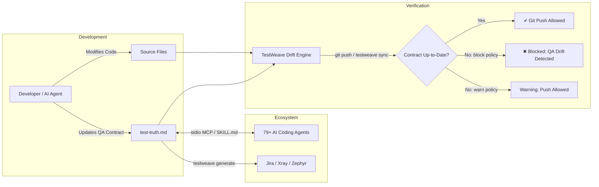

# TestWeave

<p align="center">
  <strong>Keep manual QA scenarios in step with your code.</strong>
</p>

<p align="center">
  <a href="https://github.com/AlexisRellon/TestWeave/actions/workflows/ci.yml"></a>
  <a href="https://www.npmjs.com/package/testweave"></a>
  <a href="https://www.npmjs.com/package/testweave"></a>
  
  <a href="LICENSE"></a>
  
  
</p>

---

## Overview

**TestWeave** is a CLI and local MCP server that links source files to manual QA scenarios in a versioned `test-truth.md` contract. When a developer or AI agent changes a tracked file, TestWeave checks whether the affected module's test content changed too. Run it while coding, enforce it before a Git push, or add it to pull request checks.

For example, changing `src/auth/login.ts` should prompt a review of login scenarios. If that file belongs to the `authentication` module and its contract content is unchanged, TestWeave reports `stale-module`. Update the relevant actions and expected results, then commit the contract alongside the code.

- **QA Drift Detection**: Flags tracked source changes that lack module coverage or accompanying contract updates.
- **Git Pre-Push Enforcement**: Blocks pushes with stale or uncovered changes when blocking policy is active.
- **79+ AI Coding Agent Support**: Automatically provisions standardized `SKILL.md` agent skills and IDE rules across **23 Universal agents** (`.agents/skills`) and **56 Dedicated agents** (`.claude/skills`, `.windsurf/skills`, etc.).
- **Native Model Context Protocol (MCP)**: Local stdio MCP server enabling AI agents (Cursor, Claude, Copilot, Antigravity, etc.) to inspect contracts, detect drift, and upsert test cases safely.
- **Enterprise QA Exports**: One-command export to **Jira**, **Xray**, and **Zephyr Scale** (in both CSV and JSON formats).
- **Universal Package Manager Support**: Works seamlessly across **npm**, **pnpm**, **Yarn Classic**, **modern Yarn (PnP)**, and **Bun**.

TestWeave checks file coverage and contract changes. A passing check establishes documentation alignment; reviewing scenario quality and executing tests remain part of your QA workflow. The core CLI, drift checks, MCP tools, and exports require no AI API key. Optional AI drafting sends supplied context to your selected provider.



---

**Start here:** [Quickstart](#quickstart) · [Everyday workflows](#everyday-workflows) · [Contract format](#the-living-qa-contract-test-truthmd) · [Drift rules](#drift-semantics--git-enforcement) · [MCP](#model-context-protocol-mcp-server) · [CLI reference](#cli-command-reference) · [Troubleshooting](#troubleshooting)

## Who it helps

| Your workflow | What TestWeave adds |
| :--- | :--- |
| Developers shipping behavior changes | A reminder to revise affected manual scenarios in the same change. |
| QA teams maintaining regression suites | Versioned actions, test data, and expected results, with exports for test management tools. |
| Teams using AI coding agents | Repository skills and MCP tools for reading and updating the QA contract during implementation. |
| Reviewers and maintainers | A Git or CI gate that identifies missing coverage and stale module content. |

## Quickstart

Requires **Node.js 20+**. Drift checks and pre-push enforcement require a Git repository and a resolvable comparison revision.

Install a project dependency to keep hooks and MCP registrations tied to an installed CLI:

```sh
npm install --save-dev testweave
npx --no-install testweave init
```

### 1. Initialize TestWeave in your project

Run the interactive setup in any Git repository:

```sh
npx testweave init
# or use the alias:
npx testweave setup
```

To accept defaults non-interactively (ideal for CI, scripts, or rapid onboarding):

```sh
npx testweave init --yes
```

This bootstraps:
1. An authoritative `test-truth.md` QA contract at your workspace root.
2. The Git `pre-push` hook (or Husky v9 integration).
3. Configured IDE rules (`.cursorrules`, `CLAUDE.md`, `.windsurfrules`, `.github/instructions/testweave.instructions.md`, `.vscode/mcp.json`).
4. Custom agent skill definitions (`<skillsDir>/testweave/SKILL.md`) for detected and selected agents.
5. Project MCP configuration for selected [verified clients](docs/mcp-providers.md), including Codex, Gemini CLI, OpenCode, Kilo Code, Cursor, Claude Code, and VS Code. Existing servers and comments are preserved; invalid configurations are reported without overwriting them.

Setup creates an empty `modules` array for a new contract. Before relying on the gate, register your application's modules and scenarios using the [contract example](#the-living-qa-contract-test-truthmd). Adjust `sourceGlobs` to the files you want tracked and each module's `paths` to the files it covers. Commit this initial contract as your baseline.

### Adopt an existing project

After installing TestWeave in a project already in development, scan its existing behavior:

```sh
npx --no-install testweave scan
npx --no-install testweave scan --context docs/product-context.md --json
npx --no-install testweave scan --apply
```

Scan reads available project context before implementation files: project-context, requirements, PRD, README, AGENTS, CLAUDE, architecture, user-journey documents and package manifests. Use `--context` to prioritize another document. It inventories source files, function declarations, route/CLI entry points, documented journey candidates, and existing automated test names. Discovery is local and uses filename and text heuristics; it requires no AI provider or API key.

The default is a read-only preview. `--json` includes context text, source evidence and validated module drafts. `--apply` creates a contract if needed and adds drafts for uncovered files tracked by its policy. It preserves existing modules, IDs, policy and surrounding Markdown. Repeating it on unchanged files adds nothing. Setup is still needed to install agent integrations and hooks.

Review the `needs-review` drafts, replace TODO inputs and outcomes with specific acceptance criteria from project context, and commit the baseline. Scan groups files by directory, suggests success/failure/boundary scenarios, links matching documented journeys and references discovered automated suites. It does not execute tests or certify coverage. Git projects respect standard Git ignore rules for untracked files; non-Git projects use built-in dependency/build exclusions. Linked files, binaries and files over 256 KB are skipped; scans exceeding 10,000 files fail with guidance to narrow scope.

### Your first behavior change

1. Read the module covering the source file you plan to edit.
2. Change the code and revise the module's scenarios in `test-truth.md`.
3. Run the check against your branch's upstream, or an explicit baseline:

   ```sh
   npx --no-install testweave sync --base origin/main --strict
   ```

4. Resolve reported drift, then commit the code and contract together. The pre-push hook checks the committed snapshot being pushed.

Use a revision available in your repository in place of `origin/main`. A branch without an upstream must supply `--base` for a working-tree check.

### 2. Update agent skills, IDE rules, and hooks

When upgrading TestWeave or adding new AI agents, refresh your workspace definitions:

```sh
npx testweave update
# or accept current/detected integrations non-interactively:
npx testweave update --yes
```

This synchronizes:
1. Agent custom skill files (`<skillsDir>/testweave/SKILL.md`) to the latest version.
2. Injected IDE rules (`<!-- testweave:start --> ... <!-- testweave:end -->`).
3. Git pre-push hooks and workspace `.testweave.json`.
4. Re-validates the authoritative `test-truth.md` contract.
5. Refreshes MCP launch paths for selected clients. `testweave doctor --fix` also repairs missing or outdated MCP entries.

### 3. Verify contract alignment

```sh
npx testweave sync
```

### 4. Check and repair environment diagnostics

```sh
npx testweave doctor
npx testweave doctor --fix
```

### 5. Export manual test suites

```sh
npx testweave generate --target xray --format csv --output test-cases.csv
```

---

## Package Managers

TestWeave supports **npm**, **pnpm**, **Yarn Classic**, **modern Yarn (Plug'n'Play)**, and **Bun**. Installing as a project dev dependency is recommended to keep hooks, scripts, and MCP configurations anchored to a durable version.

| Package Manager | Dev Dependency Installation | Running the Installed CLI | Registry One-Off Execution |
| :--- | :--- | :--- | :--- |
| **npm** | `npm install --save-dev testweave` | `npx --no-install testweave init` | `npx testweave init` |
| **pnpm** | `pnpm add --save-dev testweave` | `pnpm exec testweave init` | `pnpm dlx testweave init` |
| **Yarn Classic** | `yarn add --dev testweave` | `yarn run testweave init` | *(requires installation)* |
| **Yarn 2+ / Modern** | `yarn add --dev testweave` | `yarn run testweave init` | `yarn dlx testweave init` |
| **Bun** | `bun add --dev testweave` | `bun run testweave init` | `bunx testweave init` |

> [!NOTE]
> Under **Bun**, the CLI's Node shebang keeps **Node.js 20+** as the runtime. For **Yarn Plug'n'Play**, ensure `pnpEnableEsmLoader: true` is set in `.yarnrc.yml` because TestWeave is a pure ESM package. TestWeave automatically generates loaders so Git hooks and VS Code MCP servers resolve dependencies outside a Yarn shell.
>
> To update skills and rules in an existing project at any time, run `npx testweave update` (or `pnpm exec testweave update`, `bun run testweave update`).

### Universal shell installer

From your project directory, install globally through npm and automatically run `setup --yes`:

```sh
curl -fsSL https://raw.githubusercontent.com/AlexisRellon/TestWeave/main/scripts/install.sh | sh
```

Requires Node.js 20+ and npm. You can also run the script from a checkout:

```sh
sh scripts/install.sh --cwd "/path/to/project"
sh scripts/install.sh --method brew --cwd "/path/to/project"
```

The Homebrew method requires Homebrew and uses this repository's HEAD formula. Pass `--formula owner/tap/testweave` to use another already tapped formula, or `--no-setup` to install without configuring a project. The hosted commands become available once these files are published to `main`.

### Global npm installation

```sh
npm install --global testweave
testweave setup --yes
```

Run setup in each project. MCP configuration is injected during setup, using the installed CLI and Node executable.

### Homebrew

Use the repository as an explicit Homebrew tap:

```sh
brew tap alexisrellon/testweave https://github.com/AlexisRellon/TestWeave
brew install --HEAD alexisrellon/testweave/testweave
cd /path/to/project
testweave setup --yes
```

The formula builds from `main`; this is a HEAD installation through the repository tap, with no bottled release. The shell installer's `--method brew` option combines installation and project setup.

### GitHub Packages

TestWeave is also published to the GitHub Packages registry as `@alexisrellon/testweave`.

To install from GitHub Packages, configure `@alexisrellon` registry scoping in your `.npmrc`:

```ini
@alexisrellon:registry=https://npm.pkg.github.com
```

Then install as a dev dependency:

```sh
npm install --save-dev @alexisrellon/testweave
```

---

## Everyday workflows

### Review changes before committing

```sh
# Compare current files against the branch's upstream
npx --no-install testweave sync

# Compare against a specific revision and return a JSON report
npx --no-install testweave sync --base origin/main --strict --json
```

The report includes `base`, `target`, `changedFiles`, `issues`, `mode`, and `blocked`. Match each issue to its module and update scenarios that describe the changed behavior. A cosmetic rename or path edit alone does not clear a stale module.

### Ask your coding agent to maintain the contract

After selecting your agent during setup, use a prompt such as:

> Read `test-truth.md`, identify the module covering `src/auth/login.ts`, implement the login change, and update its success, failure, and boundary scenarios. Preserve existing test IDs and check drift before finishing.

Skills provide the workflow instructions. With MCP configured, the agent can read the `living-test-contract` resource, call `analyze_code_drift`, and submit a complete module through `upsert_test_module`. An upsert replaces the module with the same ID, so include all tests you intend to retain.

### Add an agent or refresh an existing setup

```sh
npx --no-install testweave update
npx --no-install testweave doctor
```

Use interactive `update` to change selected integrations, or `update --yes` to refresh the existing/default selections. Restart your MCP client after changing its registration.

### Hand scenarios to your QA team

```sh
npx --no-install testweave generate --target xray --format csv --output qa/xray-tests.csv
```

Review and import the generated artifact in your QA platform. Exports contain test definitions; they do not record execution results or upload cases automatically. Omit `--output` to print to stdout. Choose a new output filename for each export because existing files are not overwritten.

## Workspace files

| File or location | Purpose |
| :--- | :--- |
| `test-truth.md` | Authoritative contract: tracking policy, module paths, and manual test definitions. |
| `.testweave.json` | Setup selections: configuration version, integrations, and hook preference. |
| `<skillsDir>/testweave/SKILL.md` | Shared QA rules and links to task-specific guides. |
| `<skillsDir>/testweave/commands/*.md` | Guidance for scan, init/setup, update, sync, doctor, generate and MCP. |
| `<skillsDir>/testweave/references/*.md` | Contract schema and functional testing guidance loaded when needed. |
| IDE instruction files | Managed TestWeave rules alongside your existing instructions. |
| Client MCP configuration | Project registration for selected verified MCP clients. |
| Git pre-push hook / Husky integration | Runs checks on committed revisions before a push. |

The package's `skills/testweave/` directory is the authoritative skill bundle. Setup and update install its Markdown documents; doctor detects missing or modified managed files and `doctor --fix` restores them. Additional user files are preserved.

Version the contract and appropriate project configuration with your source. Put QA tracking policy in `test-truth.md`; `.testweave.json` records installation choices.

---

## The Living QA Contract (`test-truth.md`)

The authoritative contract is housed in a single top-level fenced code block labeled ````json testweave````. Any prose, Markdown headers, or comments outside this block are preserved during automated updates.

~~~json testweave
{
  "schemaVersion": 1,
  "project": "AcmeApp",
  "policy": {
    "mode": "block",
    "sourceGlobs": ["src/**/*.{ts,tsx,js,jsx}"],
    "ignoreGlobs": ["**/*.d.ts", "**/*.test.{ts,tsx}"]
  },
  "modules": [
    {
      "id": "authentication",
      "name": "User Authentication",
      "description": "User login, registration, password reset, and session management.",
      "paths": ["src/auth/**", "src/middleware/session.ts"],
      "tests": [
        {
          "id": "AUTH-001",
          "title": "Registered user logs in with valid credentials",
          "type": "smoke",
          "priority": "high",
          "preconditions": [
            "User account exists and email is verified"
          ],
          "steps": [
            {
              "action": "Navigate to /login and submit valid credentials",
              "data": "Use test fixture account credentials",
              "expected": "User is redirected to /dashboard with active session cookie"
            }
          ],
          "tags": ["smoke", "auth", "p0"]
        },
        {
          "id": "AUTH-002",
          "title": "Login fails with invalid credentials",
          "type": "regression",
          "priority": "medium",
          "preconditions": [],
          "steps": [
            {
              "action": "Submit invalid password on /login",
              "data": "user@example.com / wrongpassword",
              "expected": "Error banner displays 'Invalid credentials'; password field is cleared"
            }
          ],
          "tags": ["auth", "negative"]
        }
      ]
    }
  ]
}
~~~

### Contract Schema Structure

- **`schemaVersion`**: Currently `1`.
- **`project`**: Project display name.
- **`policy`**:
  - `mode`: `'block'` (fails check on drift) or `'warn'` (reports drift with exit code 0 unless `--strict` is passed).
  - `sourceGlobs`: Relative POSIX globs covering behavior-bearing source files.
  - `ignoreGlobs`: Files exempted from QA tracking (e.g., types, generated bundles).
- **`modules`**: Functional subsystems.
  - `id`: Unique module identifier (e.g., `authentication`).
  - `name`: Human-readable module title.
  - `description`: Scope of functional behavior covered by this module.
  - `paths`: Array of POSIX globs mapping files to this module.
  - `tests`: Array of test definitions.
    - `id`: Globally unique test ID across the entire contract (e.g., `AUTH-001`).
    - `title`: Clear test scenario title.
    - `type`: `unit`, `integration`, `system`, `sanity`, `smoke`, `regression`, `uat`, `ui`, `api`, `interface`, `component`, or `e2e`. Defaults to `regression` when omitted.
    - `priority`: `'low'` | `'medium'` | `'high'` | `'critical'`.
    - `preconditions`: List of prerequisite conditions.
    - `steps`: Array of manual test steps:
      - `action`: What the tester or runner executes.
      - `data`: Inputs, parameters, or test data.
      - `expected`: The verified observable outcome.
    - `tags`: Array of searchable labels (e.g., `["auth", "negative"]`); use `[]` when none apply.

### Authoring scenarios

Keep module IDs and test IDs stable so reviewers and exports can track the same cases over time. Give each module at least one test and each test at least one step. Use observable expected results, representative input data, and explicit preconditions. Include success, failure, and boundary cases for the behavior you cover.

Paths use positive, workspace-relative globs with forward slashes, including on Windows. Use `src/auth/**` rather than an absolute path or a backslash path. Store exclusions in `ignoreGlobs` rather than using negated patterns.

---

## Drift Semantics & Git Enforcement

TestWeave enforces manual QA synchronization with strict, conservative rules:

1. **Working Tree vs. Upstream (`testweave sync`)**:
   - Compares the working tree, staged changes, and untracked files against the upstream tracking branch or an explicit `--base <ref>`.
2. **Pre-Push Enforcer (`.git/hooks/pre-push`)**:
   - Intercepts Git's ref-update stream and inspects the **committed local SHA being pushed** against the remote SHA.
   - An uncommitted or dirty `test-truth.md` cannot make a stale committed push pass.
3. **Module Coverage Requirements**:
   - Every modified source file matching `sourceGlobs` must map to at least one registered module.
   - Every existing affected module must have a change to its description or test content. Reordering test cases, touching paths only, or renaming modules does not clear drift. Reviewers must assess whether the content change adequately covers the source change.
4. **Anti-Evasion Policy**:
   - Evaluates both baseline and proposed policies: a branch cannot bypass drift checks by weakening its ignore globs or changing `mode: "block"` to `mode: "warn"`.
5. **Exit Codes**:
   - `0`: Success (or warning-mode drift).
   - `1`: Blocked drift, failed diagnostics, or CLI usage error.
   - `2`: Schema validation or operational error.

### Understanding drift reports

| Issue | Meaning | Resolution |
| :--- | :--- | :--- |
| `unmapped` | A changed tracked file matches no module in either the baseline or current contract. | Add a module with matching paths and relevant scenarios, or extend the appropriate module. |
| `stale-module` | Source covered by an existing module changed while its description and test content stayed the same. | Revise the affected scenarios to describe the change, including regression expectations. |
| `removed-module` | A module covering changed files was deleted from the proposed contract. | Retain the module and document the retired behavior. |

The checker uses the union of baseline and current tracking rules and module paths. When a file matches multiple modules, each affected module is evaluated. Even a refactor of a tracked file prompts a contract update; document the regression checks that confirm the expected behavior.

---

## 79+ AI Coding Agent Ecosystem

TestWeave includes deep support for modern AI agents and IDEs. During initialization or updates (`testweave setup`, `testweave init`, or `testweave update`), an interactive selector allows choosing from **79 supported agents**. Run `npx testweave update` at any time to synchronize newly released agent skills and refreshed prompts into your repository without overwriting existing test scenarios.

```
  ████████╗███████╗███████╗████████╗██╗    ██╗███████╗ █████╗ ██╗   ██╗███████╗
  ╚══██╔══╝██╔════╝██╔════╝╚══██╔══╝██║    ██║██╔════╝██╔══██╗██║   ██║██╔════╝
     ██║   █████╗  ███████╗   ██║   ██║ █╗ ██║█████╗  ███████║██║   ██║█████╗  
     ██║   ██╔══╝  ╚════██║   ██║   ██║███╗██║██╔══╝  ██╔══██║╚██╗ ██╔╝██╔══╝  
     ██║   ███████╗███████║   ██║   ╚███╔███╔╝███████╗██║  ██║ ╚████╔╝ ███████╗
     ╚═╝   ╚══════╝╚══════╝   ╚═╝    ╚══╝╚══╝ ╚══════╝╚═╝  ╚═╝  ╚═══╝  ╚══════╝
   testweave 
```

### Universal Agent Standard (`.agents/skills`)
TestWeave deploys a standardized agent skill (`.agents/skills/testweave/SKILL.md`) that works out of the box across **23 Universal Agents**:

| Universal Agents (`.agents/skills`) | | |
| :--- | :--- | :--- |
| • Antigravity & Antigravity CLI | • Amp | • Cline |
| • Codex | • Cursor | • Deep Agents |
| • Dexto | • Droid | • Firebender |
| • fx | • Gemini CLI | • GitHub Copilot |
| • Kilo Code | • Kimi Code CLI | • Loaf |
| • OpenCode | • Pi | • Replit |
| • Sarvam Code | • Warp | • Zed |
| • PromptScript | | |

### Dedicated Agent Integrations
For agents and IDEs requiring specific configuration files or custom skills directories, TestWeave automatically provisions target-specific rules and skills:

- **Claude Code**: Rules in `CLAUDE.md`, skill in `.claude/skills/testweave/SKILL.md`
- **Windsurf**: Rules in `.windsurfrules`, skill in `.windsurf/skills/testweave/SKILL.md`
- **VS Code**: Auto-discovered instructions in `.github/instructions/testweave.instructions.md`, MCP entry in `.vscode/mcp.json`
- **Devin for Terminal**: `.devin/skills/testweave/SKILL.md`
- **OpenHands**: `.openhands/skills/testweave/SKILL.md`
- **AiderDesk**: `.aider-desk/skills/testweave/SKILL.md`
- **Continue, Goose, Grok, Trae, Roo Code, Tabnine CLI, and 45+ more**.

### Managed Rule Markers
IDE rules are safely embedded using non-destructive markers:
```markdown
<!-- testweave:start -->
## TestWeave QA contract
- Read test-truth.md before changing source behavior.
- Every changed source file must match a registered module's paths.
- Update that module's manual test actions and expected results alongside code changes.
...
<!-- testweave:end -->
```
Any pre-existing user instructions outside these markers are preserved intact.

---

## Model Context Protocol (MCP) Server

TestWeave includes a built-in stdio [Model Context Protocol (MCP)](https://modelcontextprotocol.io) server. AI assistants can directly interact with your living QA contract.

Start the server manually or through your MCP client:
```sh
npx --no-install testweave mcp
```

### MCP Client Configurations

Setup, init, and update automatically merge the `testweave` server for 26 verified clients when selected. Doctor can repair their registrations. Universal agents with native MCP support are individually selectable; selecting universal skills alone does not register them. Generated entries use absolute Node and installed CLI paths with `--cwd` bound to the project, retaining Yarn PnP loaders when needed. See the [provider compatibility guide](docs/mcp-providers.md) for paths, formats, official sources, and registration guidance across the full 79-agent skill catalog.

#### Register a provider or custom client

Register one verified provider without running full setup, or print its native configuration:

```sh
testweave mcp install --provider codex
testweave mcp install --provider gemini-cli
testweave mcp install --provider opencode
testweave mcp config --provider mistral-vibe
```

Provider registration uses project files. Codex and Grok use TOML tables; Mistral Vibe uses TOML array tables; OpenCode, Kilo Code and Posit Assistant use command arrays. Existing `opencode.jsonc` and root Kilo configs are preferred when present. Provider options cannot be combined with custom config paths or server-map keys.

Inject into any workspace JSON/JSONC MCP configuration, preserving comments and other servers. Set the server-map key to match your client (default: `mcpServers`):

```sh
testweave mcp install --config .other-client/mcp.json --key servers
testweave mcp config
testweave mcp config --format toml
```

The config commands print absolute launch paths for manual use, including clients whose settings live outside the workspace. The TOML output is a Codex `[mcp_servers.testweave]` entry. Add it to your Codex config, or register the built local CLI:

```sh
codex mcp add testweave -- node /absolute/path/to/TestWeave/dist/cli/index.js --cwd /absolute/path/to/project mcp
codex mcp get testweave
```

Restart the Codex session after registration to load the server; project configuration requires a trusted workspace. Custom JSON injection is explicit; setup/update/doctor manage selected verified provider locations. For an existing inline or dotted TestWeave TOML declaration, convert it to a dedicated table before automatic update.

#### Cursor (`.cursor/mcp.json`)
```json
{
  "mcpServers": {
    "testweave": {
      "command": "npx",
      "args": ["--no-install", "testweave", "--cwd", "/absolute/path/to/project", "mcp"]
    }
  }
}
```

#### Claude Code (`.mcp.json`)

Configured automatically during setup when Claude Code is selected. Claude Desktop uses its separate `claude_desktop_config.json`, which can be configured manually.
```json
{
  "mcpServers": {
    "testweave": {
      "command": "npx",
      "args": ["--no-install", "testweave", "--cwd", "/absolute/path/to/project", "mcp"]
    }
  }
}
```

#### VS Code (`.vscode/mcp.json`)
Configured automatically during `init`. Uses a direct `node` invocation with native path escaping:
```json
{
  "servers": {
    "testweave": {
      "command": "node",
      "args": ["/path/to/testweave/dist/cli/index.js", "--cwd", "/absolute/path/to/project", "mcp"]
    }
  }
}
```

### MCP Capabilities & Tools

| Capability / Tool | Type | Description |
| :--- | :--- | :--- |
| `living-test-contract` | Resource | Living `test-truth.md` contract resource (`file:///<root>/test-truth.md`, MIME `text/markdown`). |
| `analyze_code_drift` | Tool | Compares working files against upstream or `--base`. Returns a full JSON drift report. |
| `upsert_test_module` | Tool | Safely creates or updates a module in `test-truth.md`. Uses atomic file locking (`test-truth.md.lock`) and validates the full schema before writing. |
| `generate_qa_export` | Tool | Returns test definitions formatted for Jira, Xray, or Zephyr without modifying disk. |

---

## Enterprise QA Exporters

Generate ready-to-import test artifacts for external test management tools:

```sh
# Export for Xray (CSV)
npx testweave generate --target xray --format csv --output xray-tests.csv

# Export for Zephyr Scale (JSON bundle with project key)
npx testweave generate --target zephyr --format json --project-key PROJ --output zephyr-bundle.json

# Export for Jira (CSV)
npx testweave generate --target jira --format csv --output jira-issues.csv
```

### Export Formats & Profiles

| Target | CSV Format | JSON Format |
| :--- | :--- | :--- |
| **Jira** | Standard Jira CSV issue rows; manual test steps formatted inside the Description field. | Jira external-system import schema (`projects[].issues[]`). |
| **Xray** | Compatible with Xray Test Case Importer; steps grouped by Test Case Identifier. | Xray manual test import payload with structured `fields` and `steps`. |
| **Zephyr Scale** | Step-by-step CSV format with blank metadata on continuation rows. | REST bundle containing individual case payloads and step definitions. |

> [!TIP]
> **Spreadsheet Safety**: TestWeave's CSV serializer automatically prefixes formula-triggering characters (`=`, `+`, `-`, `@`) with an apostrophe and properly quotes multi-line text and embedded quotes.

---

## AI Test Drafting (Optional)

Draft new QA modules or test cases directly from technical specs using OpenAI or Anthropic:

```sh
# Using OpenAI (requires OPENAI_API_KEY)
npx testweave generate --provider openai --model gpt-4o --context specs/payment.md --output drafts/payment.json

# Using Anthropic (requires ANTHROPIC_API_KEY)
npx testweave generate --provider anthropic --model claude-3-5-sonnet-20241022 --context specs/auth.md --module authentication --output drafts/auth.json
```

- **OpenAI**: Enforces the contract schema via Structured Outputs.
- **Anthropic**: Enforces the contract schema via tool schema constraints.
- Generated modules are validated with Zod before output. Drafting never silently alters `test-truth.md`—you review and apply drafts explicitly.
- Only the supplied context file and, when requested, the selected existing module are sent to the provider. API credentials are read from the corresponding environment variable.

---

## CLI Command Reference

```
Usage: testweave [options] [command]

Options:
  --cwd <directory>    Target project directory (default: current working directory or Git root)
  -h, --help           Display help for command
  -V, --version        Output current version

Commands:
  init, setup [options]
    -y, --yes          Accept default/detected integrations non-interactively
    --no-hook          Skip installing Git pre-push hook

  update [options]
    -y, --yes          Accept default/existing integrations non-interactively
    --no-hook          Skip installing or updating Git pre-push hook

  sync [options]
    --base <ref>       Git revision baseline to compare against (default: upstream tracking branch)
    --strict           Force blocking mode (exit code 1) even if policy is set to "warn"
    --json             Output drift report as machine-readable JSON
    --pre-push         Read Git ref updates from stdin (used by the installed hook)

  doctor [options]
    --fix              Repair supported contract, configuration, rule, and hook problems
    --json             Output machine-readable diagnostics

  scan [options]
    --context <file>   Prioritize a workspace-relative project context document
    --json             Preview context, source evidence and module drafts as JSON
    --apply            Add uncovered drafts to test-truth.md without replacing existing modules

  generate [options]
    --target <target>  Target QA platform: "jira", "xray", or "zephyr"
    --format <format>  Output format: "csv" or "json"
    --output <file>    Destination file (must be a new file inside the workspace)
    --project-key <k>  Destination project key (required for JSON exports)
    --provider <prov>  AI drafting provider: "openai" or "anthropic"
    --model <model>    AI model identifier
    --context <file>   Context Markdown file for AI drafting
    --module <id>      Target module ID for AI refinement

  mcp
    Starts the stdio Model Context Protocol (MCP) server

  mcp config [options]
    --provider <id>    Print configuration for a verified client
    --format <format> json or toml (default: provider format)
    --key <key>       JSON server map key (default: mcpServers)

  mcp install [options]
    --provider <id>    Register a verified client in its project configuration
    --config <file>   Custom workspace-relative JSON/JSONC configuration
    --key <key>       Custom server map key (default: mcpServers)
```

---

## CI / CD Integration

Enforce QA contract compliance in your pull request pipelines:

### GitHub Actions (`.github/workflows/qa-drift.yml`)

```yaml
name: QA Contract Check

on:
  pull_request:
    branches: [main, master]

jobs:
  testweave-sync:
    runs-on: ubuntu-latest
    steps:
      - name: Checkout Code
        uses: actions/checkout@v4
        with:
          fetch-depth: 0 # Full history needed for base ref comparison

      - name: Setup Node.js
        uses: actions/setup-node@v4
        with:
          node-version: 20
          cache: npm

      - name: Install Dependencies
        run: npm ci

      - name: Verify Zero QA Drift
        run: npx --no-install testweave sync --base origin/${{ github.base_ref }} --strict
```

*(For `pnpm`, `yarn`, or `bun`, substitute `pnpm exec testweave sync ...`, `yarn run testweave sync ...`, or `bun run testweave sync ...`)*

---

## Troubleshooting

| Symptom | What to do |
| :--- | :--- |
| `No upstream branch` | Supply `sync --base <ref>` with an existing revision, or configure the branch's upstream. |
| Source changes are not reported | Check `policy.sourceGlobs` and `ignoreGlobs` in both baseline and current contracts. A file must be tracked by policy to be checked. |
| Local sync passes but push fails | The hook checks committed snapshots. Commit the corrected contract together with the source change and check the baseline used for the push. |
| Contract parsing or validation fails | Keep exactly one top-level `json testweave` fence, valid JSON, unique module/test IDs, and all required fields. Run `doctor` for diagnostics. |
| Rules, skills, hooks, or MCP entries are missing | Run `doctor --fix`, then `update` if you need to select another integration. |
| Agent cannot find MCP tools | Check its registration with `mcp config --provider <id>`, confirm the installed CLI still exists, and restart the client. See the [compatibility guide](docs/mcp-providers.md). |
| Export fails because a file exists | Select a new workspace-relative output path, or omit `--output` to print the artifact. |
| JSON export reports a missing project key | Add `--project-key PROJ` for Jira, Xray, and Zephyr JSON exports. |

For a diagnostic report:

```sh
npx --no-install testweave doctor --json
```

---

## Contributing & Development

```sh
# Clone and install dependencies
git clone https://github.com/AlexisRellon/TestWeave.git
cd TestWeave
npm ci

# Run TypeScript checks, builds, and test suite
npm run check

# Run tests across package managers (npm, pnpm, yarn, bun)
npm run check:manager -- npm
npm run check:manager -- pnpm
npm run check:manager -- yarn-classic
npm run check:manager -- yarn-pnp
npm run check:manager -- bun
```

Contributions are welcome! Please consult [CONTRIBUTING.md](CONTRIBUTING.md), adhere to our [Code of Conduct](CODE_OF_CONDUCT.md), and follow [SECURITY.md](SECURITY.md) for vulnerability reports.

### Architecture
- **`src/cli` & `src/mcp`**: CLI commands, interactive TTY UI, banner, agent selector, and stdio MCP server.
- **`src/engine`**: Contract store, atomic file writer, Git diff analyzer, and doctor diagnostics.
- **`src/integrations`**: Agent definitions (79+ agents), skills installer, IDE rule injectors, Git hooks, and Jira/Xray/Zephyr exporters.
- **`src/schema`**: Authoritative Zod schemas for contracts, modules, and policies.
- **`src/llm`**: Structured output adapters for OpenAI and Anthropic.

---

## License

[MIT](LICENSE) © Alexis Rellon
