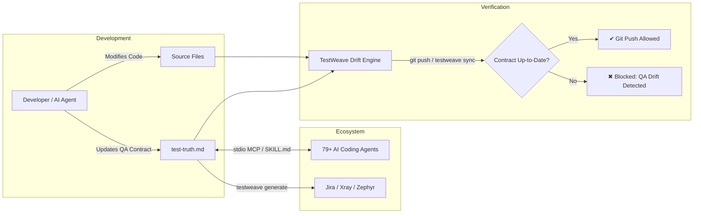

# TestWeave

<p align="center">
  <strong>The living manual QA contract engine for software teams and AI coding agents.</strong>
</p>

<p align="center">
  <a href="https://github.com/AlexisRellon/TestWeave/actions/workflows/ci.yml"></a>
  <a href="https://www.npmjs.com/package/testweave"></a>
  
  <a href="LICENSE"></a>
  
  
</p>

---

## Overview

**TestWeave** binds manual QA specifications directly to source code inside your Git repository in `test-truth.md`. It turns static, neglected test documentation into an actively enforced contract that evolves alongside your codebase.

- **Zero QA Drift**: Detects whenever source code modifications alter behavior without corresponding manual QA scenario updates.
- **Git Pre-Push Enforcement**: Blocks stale or uncovered commits before they ever leave a developer's workstation.
- **79+ AI Coding Agent Support**: Automatically provisions standardized `SKILL.md` agent skills and IDE rules across **23 Universal agents** (`.agents/skills`) and **56 Dedicated agents** (`.claude/skills`, `.windsurf/skills`, etc.).
- **Native Model Context Protocol (MCP)**: Local stdio MCP server enabling AI agents (Cursor, Claude, Copilot, Antigravity, etc.) to inspect contracts, detect drift, and upsert test cases safely.
- **Enterprise QA Exports**: One-command export to **Jira**, **Xray**, and **Zephyr Scale** (in both CSV and JSON formats).
- **Universal Package Manager Support**: Works seamlessly across **npm**, **pnpm**, **Yarn Classic**, **modern Yarn (PnP)**, and **Bun**.



---

## Quickstart

### 1. Initialize TestWeave in your project

Run the interactive setup in any Git repository:

```sh
npx testweave init
# or use the alias:
npx testweave setup
```

To accept defaults non-interactively (ideal for CI, scripts, or rapid onboarding):

```sh
npx testweave init --yes
```

This bootstraps:
1. An authoritative `test-truth.md` QA contract at your workspace root.
2. The Git `pre-push` hook (or Husky v9 integration).
3. Configured IDE rules (`.cursorrules`, `CLAUDE.md`, `.windsurfrules`, `.github/instructions/testweave.instructions.md`, `.vscode/mcp.json`).
4. Custom agent skill definitions (`<skillsDir>/testweave/SKILL.md`) for detected and selected agents.

### 2. Verify contract alignment

```sh
npx testweave sync
```

### 3. Check and repair environment diagnostics

```sh
npx testweave doctor
npx testweave doctor --fix
```

### 4. Export manual test suites

```sh
npx testweave generate --target xray --format csv --output test-cases.csv
```

---

## Package Managers

TestWeave supports **npm**, **pnpm**, **Yarn Classic**, **modern Yarn (Plug'n'Play)**, and **Bun**. Installing as a project dev dependency is recommended to keep hooks, scripts, and MCP configurations anchored to a durable version.

| Package Manager | Dev Dependency Installation | Running the Installed CLI | Registry One-Off Execution |
| :--- | :--- | :--- | :--- |
| **npm** | `npm install --save-dev testweave` | `npx --no-install testweave init` | `npx testweave init` |
| **pnpm** | `pnpm add --save-dev testweave` | `pnpm exec testweave init` | `pnpm dlx testweave init` |
| **Yarn Classic** | `yarn add --dev testweave` | `yarn run testweave init` | *(requires installation)* |
| **Yarn 2+ / Modern** | `yarn add --dev testweave` | `yarn run testweave init` | `yarn dlx testweave init` |
| **Bun** | `bun add --dev testweave` | `bun run testweave init` | `bunx testweave init` |

> [!NOTE]
> Under **Bun**, the CLI's Node shebang keeps **Node.js 20+** as the runtime. For **Yarn Plug'n'Play**, ensure `pnpEnableEsmLoader: true` is set in `.yarnrc.yml` because TestWeave is a pure ESM package. TestWeave automatically generates loaders so Git hooks and VS Code MCP servers resolve dependencies outside a Yarn shell.

### GitHub Packages

TestWeave is also published to the GitHub Packages registry as `@alexisrellon/testweave`.

To install from GitHub Packages, configure `@alexisrellon` registry scoping in your `.npmrc`:

```ini
@alexisrellon:registry=https://npm.pkg.github.com
```

Then install as a dev dependency:

```sh
npm install --save-dev @alexisrellon/testweave
```

---

## The Living QA Contract (`test-truth.md`)

The authoritative contract is housed in a single top-level fenced code block labeled ````json testweave````. Any prose, Markdown headers, or comments outside this block are preserved during automated updates.

~~~json testweave
{
  "schemaVersion": 1,
  "project": "AcmeApp",
  "policy": {
    "mode": "block",
    "sourceGlobs": ["src/**/*.{ts,tsx,js,jsx}"],
    "ignoreGlobs": ["**/*.d.ts", "**/*.test.{ts,tsx}"]
  },
  "modules": [
    {
      "id": "authentication",
      "name": "User Authentication",
      "description": "User login, registration, password reset, and session management.",
      "paths": ["src/auth/**", "src/middleware/session.ts"],
      "tests": [
        {
          "id": "AUTH-001",
          "title": "Registered user logs in with valid credentials",
          "priority": "high",
          "preconditions": [
            "User account exists and email is verified"
          ],
          "steps": [
            {
              "action": "Navigate to /login and submit valid credentials",
              "data": "Use test fixture account credentials",
              "expected": "User is redirected to /dashboard with active session cookie"
            }
          ],
          "tags": ["smoke", "auth", "p0"]
        },
        {
          "id": "AUTH-002",
          "title": "Login fails with invalid credentials",
          "priority": "medium",
          "preconditions": [],
          "steps": [
            {
              "action": "Submit invalid password on /login",
              "data": "user@example.com / wrongpassword",
              "expected": "Error banner displays 'Invalid credentials'; password field is cleared"
            }
          ],
          "tags": ["auth", "negative"]
        }
      ]
    }
  ]
}
~~~

### Contract Schema Structure

- **`schemaVersion`**: Currently `1`.
- **`project`**: Project display name.
- **`policy`**:
  - `mode`: `'block'` (fails check on drift) or `'warn'` (reports drift with exit code 0 unless `--strict` is passed).
  - `sourceGlobs`: Relative POSIX globs covering behavior-bearing source files.
  - `ignoreGlobs`: Files exempted from QA tracking (e.g., types, generated bundles).
- **`modules`**: Functional subsystems.
  - `id`: Unique module identifier (e.g., `authentication`).
  - `name`: Human-readable module title.
  - `description`: Scope of functional behavior covered by this module.
  - `paths`: Array of POSIX globs mapping files to this module.
  - `tests`: Array of test definitions.
    - `id`: Globally unique test ID across the entire contract (e.g., `AUTH-001`).
    - `title`: Clear test scenario title.
    - `priority`: `'low'` | `'medium'` | `'high'` | `'critical'`.
    - `preconditions`: List of prerequisite conditions.
    - `steps`: Array of manual test steps:
      - `action`: What the tester or runner executes.
      - `data`: Inputs, parameters, or test data.
      - `expected`: The verified observable outcome.
    - `tags`: Optional searchable labels (e.g., `["smoke", "regression"]`).

---

## Drift Semantics & Git Enforcement

TestWeave enforces manual QA synchronization with strict, conservative rules:

1. **Working Tree vs. Upstream (`testweave sync`)**:
   - Compares the working tree, staged changes, and untracked files against the upstream tracking branch or an explicit `--base <ref>`.
2. **Pre-Push Enforcer (`.git/hooks/pre-push`)**:
   - Intercepts Git's ref-update stream and inspects the **committed local SHA being pushed** against the remote SHA.
   - An uncommitted or dirty `test-truth.md` cannot make a stale committed push pass.
3. **Module Coverage Requirements**:
   - Every modified source file matching `sourceGlobs` must map to at least one registered module.
   - Every affected module must have substantive test modifications (updated steps, actions, expectations, or descriptions). Reordering test cases, touching paths only, or renaming modules does not clear drift.
4. **Anti-Evasion Policy**:
   - Evaluates both baseline and proposed policies: a branch cannot bypass drift checks by weakening its ignore globs or changing `mode: "block"` to `mode: "warn"`.
5. **Exit Codes**:
   - `0`: Success (or warning-mode drift).
   - `1`: Blocked drift, failed diagnostics, or CLI usage error.
   - `2`: Schema validation or operational error.

---

## 79+ AI Coding Agent Ecosystem

TestWeave includes deep support for modern AI agents and IDEs. During initialization (`testweave setup` or `testweave init`), an interactive selector allows choosing from **79 supported agents**.

```
  ████████╗███████╗███████╗████████╗██╗    ██╗███████╗ █████╗ ██╗   ██╗███████╗
  ╚══██╔══╝██╔════╝██╔════╝╚══██╔══╝██║    ██║██╔════╝██╔══██╗██║   ██║██╔════╝
     ██║   █████╗  ███████╗   ██║   ██║ █╗ ██║█████╗  ███████║██║   ██║█████╗  
     ██║   ██╔══╝  ╚════██║   ██║   ██║███╗██║██╔══╝  ██╔══██║╚██╗ ██╔╝██╔══╝  
     ██║   ███████╗███████║   ██║   ╚███╔███╔╝███████╗██║  ██║ ╚████╔╝ ███████╗
     ╚═╝   ╚══════╝╚══════╝   ╚═╝    ╚══╝╚══╝ ╚══════╝╚═╝  ╚═╝  ╚═══╝  ╚══════╝
   testweave 
```

### Universal Agent Standard (`.agents/skills`)
TestWeave deploys a standardized agent skill (`.agents/skills/testweave/SKILL.md`) that works out of the box across **23 Universal Agents**:

| Universal Agents (`.agents/skills`) | | |
| :--- | :--- | :--- |
| • Antigravity & Antigravity CLI | • Amp | • Cline |
| • Codex | • Cursor | • Deep Agents |
| • Dexto | • Droid | • Firebender |
| • fx | • Gemini CLI | • GitHub Copilot |
| • Kilo Code | • Kimi Code CLI | • Loaf |
| • OpenCode | • Pi | • Replit |
| • Sarvam Code | • Warp | • Zed |
| • PromptScript | | |

### Dedicated Agent Integrations
For agents and IDEs requiring specific configuration files or custom skills directories, TestWeave automatically provisions target-specific rules and skills:

- **Claude Code**: Rules in `CLAUDE.md`, skill in `.claude/skills/testweave/SKILL.md`
- **Windsurf**: Rules in `.windsurfrules`, skill in `.windsurf/skills/testweave/SKILL.md`
- **VS Code**: Auto-discovered instructions in `.github/instructions/testweave.instructions.md`, MCP entry in `.vscode/mcp.json`
- **Devin for Terminal**: `.devin/skills/testweave/SKILL.md`
- **OpenHands**: `.openhands/skills/testweave/SKILL.md`
- **AiderDesk**: `.aider-desk/skills/testweave/SKILL.md`
- **Continue, Goose, Grok, Trae, Roo Code, Tabnine CLI, and 45+ more**.

### Managed Rule Markers
IDE rules are safely embedded using non-destructive markers:
```markdown
<!-- testweave:start -->
## TestWeave QA contract
- Read test-truth.md before changing source behavior.
- Every changed source file must match a registered module's paths.
- Update that module's manual test actions and expected results alongside code changes.
...
<!-- testweave:end -->
```
Any pre-existing user instructions outside these markers are preserved intact.

---

## Model Context Protocol (MCP) Server

TestWeave includes a built-in stdio [Model Context Protocol (MCP)](https://modelcontextprotocol.io) server. AI assistants can directly interact with your living QA contract.

Start the server manually or through your MCP client:
```sh
npx --no-install testweave mcp
```

### MCP Client Configurations

#### Cursor (`.cursor/mcp.json`)
```json
{
  "mcpServers": {
    "testweave": {
      "command": "npx",
      "args": ["--no-install", "testweave", "--cwd", "/absolute/path/to/project", "mcp"]
    }
  }
}
```

#### Claude Desktop / Claude Code (`claude_desktop_config.json`)
```json
{
  "mcpServers": {
    "testweave": {
      "command": "npx",
      "args": ["--no-install", "testweave", "--cwd", "/absolute/path/to/project", "mcp"]
    }
  }
}
```

#### VS Code (`.vscode/mcp.json`)
Configured automatically during `init`. Uses a direct `node` invocation with native path escaping:
```json
{
  "servers": {
    "testweave": {
      "command": "node",
      "args": ["/path/to/testweave/dist/cli/index.js", "--cwd", "/absolute/path/to/project", "mcp"]
    }
  }
}
```

### MCP Capabilities & Tools

| Capability / Tool | Type | Description |
| :--- | :--- | :--- |
| `living-test-contract` | Resource | Living `test-truth.md` contract resource (`file:///<root>/test-truth.md`, MIME `text/markdown`). |
| `analyze_code_drift` | Tool | Compares working files against upstream or `--base`. Returns a full JSON drift report. |
| `upsert_test_module` | Tool | Safely creates or updates a module in `test-truth.md`. Uses atomic file locking (`test-truth.md.lock`) and validates the full schema before writing. |
| `generate_qa_export` | Tool | Returns test definitions formatted for Jira, Xray, or Zephyr without modifying disk. |

---

## Enterprise QA Exporters

Generate ready-to-import test artifacts for external test management tools:

```sh
# Export for Xray (CSV)
npx testweave generate --target xray --format csv --output xray-tests.csv

# Export for Zephyr Scale (JSON bundle with project key)
npx testweave generate --target zephyr --format json --project-key PROJ --output zephyr-bundle.json

# Export for Jira (CSV)
npx testweave generate --target jira --format csv --output jira-issues.csv
```

### Export Formats & Profiles

| Target | CSV Format | JSON Format |
| :--- | :--- | :--- |
| **Jira** | Standard Jira CSV issue rows; manual test steps formatted inside the Description field. | Jira external-system import schema (`projects[].issues[]`). |
| **Xray** | Compatible with Xray Test Case Importer; steps grouped by Test Case Identifier. | Xray manual test import payload with structured `fields` and `steps`. |
| **Zephyr Scale** | Step-by-step CSV format with blank metadata on continuation rows. | REST bundle containing individual case payloads and step definitions. |

> [!TIP]
> **Spreadsheet Safety**: TestWeave's CSV serializer automatically prefixes formula-triggering characters (`=`, `+`, `-`, `@`) with an apostrophe and properly quotes multi-line text and embedded quotes.

---

## AI Test Drafting (Optional)

Draft new QA modules or test cases directly from technical specs using OpenAI or Anthropic:

```sh
# Using OpenAI (requires OPENAI_API_KEY)
npx testweave generate --provider openai --model gpt-4o --context specs/payment.md --output drafts/payment.json

# Using Anthropic (requires ANTHROPIC_API_KEY)
npx testweave generate --provider anthropic --model claude-3-5-sonnet-20241022 --context specs/auth.md --module authentication --output drafts/auth.json
```

- **OpenAI**: Enforces the contract schema via Structured Outputs.
- **Anthropic**: Enforces the contract schema via tool schema constraints.
- Generated modules are validated with Zod before output. Drafting never silently alters `test-truth.md`—you review and apply drafts explicitly.

---

## CLI Command Reference

```
Usage: testweave [options] [command]

Options:
  --cwd <directory>    Target project directory (default: current working directory or Git root)
  -h, --help           Display help for command
  -v, --version        Output current version

Commands:
  init, setup [options]
    -y, --yes          Accept default/detected integrations non-interactively
    --no-hook          Skip installing Git pre-push hook

  sync [options]
    --base <ref>       Git revision baseline to compare against (default: upstream tracking branch)
    --strict           Force blocking mode (exit code 1) even if policy is set to "warn"
    --json             Output drift report as machine-readable JSON

  doctor [options]
    --fix              Automatically repair missing hooks, broken rules, or unformatted configs

  generate [options]
    --target <target>  Target QA platform: "jira", "xray", or "zephyr"
    --format <format>  Output format: "csv" or "json"
    --output <file>    Destination file (must be a new file inside the workspace)
    --project-key <k>  Destination project key (required for JSON exports)
    --provider <prov>  AI drafting provider: "openai" or "anthropic"
    --model <model>    AI model identifier
    --context <file>   Context Markdown file for AI drafting
    --module <id>      Target module ID for AI refinement

  mcp
    Starts the stdio Model Context Protocol (MCP) server
```

---

## CI / CD Integration

Enforce QA contract compliance in your pull request pipelines:

### GitHub Actions (`.github/workflows/qa-drift.yml`)

```yaml
name: QA Contract Check

on:
  pull_request:
    branches: [main, master]

jobs:
  testweave-sync:
    runs-on: ubuntu-latest
    steps:
      - name: Checkout Code
        uses: actions/checkout@v4
        with:
          fetch-depth: 0 # Full history needed for base ref comparison

      - name: Setup Node.js
        uses: actions/setup-node@v4
        with:
          node-version: 20
          cache: npm

      - name: Install Dependencies
        run: npm ci

      - name: Verify Zero QA Drift
        run: npx --no-install testweave sync --base origin/${{ github.base_ref }} --strict
```

*(For `pnpm`, `yarn`, or `bun`, substitute `pnpm exec testweave sync ...`, `yarn run testweave sync ...`, or `bun run testweave sync ...`)*

---

## Contributing & Development

```sh
# Clone and install dependencies
git clone https://github.com/AlexisRellon/TestWeave.git
cd TestWeave
npm ci

# Run TypeScript checks, builds, and test suite
npm run check

# Run tests across package managers (npm, pnpm, yarn, bun)
npm run check:manager -- npm
npm run check:manager -- pnpm
npm run check:manager -- yarn-classic
npm run check:manager -- yarn-pnp
npm run check:manager -- bun
```

Contributions are welcome! Please consult [CONTRIBUTING.md](CONTRIBUTING.md), adhere to our [Code of Conduct](CODE_OF_CONDUCT.md), and follow [SECURITY.md](SECURITY.md) for vulnerability reports.

### Architecture
- **`src/cli` & `src/mcp`**: CLI commands, interactive TTY UI, banner, agent selector, and stdio MCP server.
- **`src/engine`**: Contract store, atomic file writer, Git diff analyzer, and doctor diagnostics.
- **`src/integrations`**: Agent definitions (79+ agents), skills installer, IDE rule injectors, Git hooks, and Jira/Xray/Zephyr exporters.
- **`src/schema`**: Authoritative Zod schemas for contracts, modules, and policies.
- **`src/llm`**: Structured output adapters for OpenAI and Anthropic.

---

## License

[MIT](LICENSE) © Alexis Rellon
